# Curling Timer for the M5Stack StopWatch

Firmware that turns the [M5Stack StopWatch](https://docs.m5stack.com/en/core/StopWatch) (SKU C152) into a dedicated curling stone timer.

Tap the yellow button as the stone crosses each line. The watch shows the **split time** (back line to near hog) with the **weight** it means, the **hog-to-hog time** (the ice speed), or both from a single stone. Every tap buzzes, so you can keep your eyes on the stone. Results are kept in a history you can review between ends, and the weight bands can be tuned on the watch to match the ice.

**Current version: 0.2.2.** Every feature has been bench-tested on the device; see [STATUS](docs/STATUS.md). The default weight bands are placeholders until they're calibrated on real ice.

<table><tr><td align="center">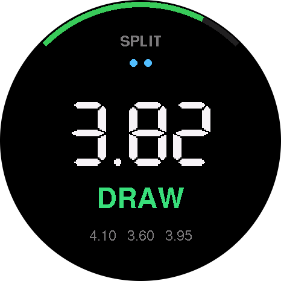<br><sub>Split with its weight band</sub></td><td align="center">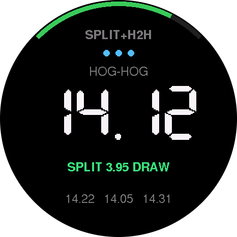<br><sub>Split + hog-to-hog</sub></td><td align="center">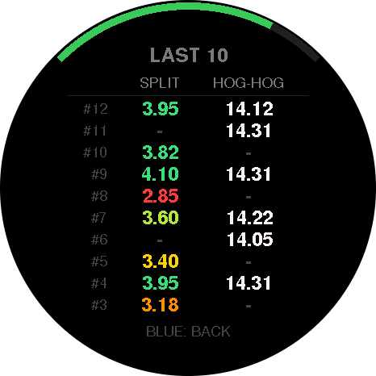<br><sub>History</sub></td></tr></table>

<sub>Screens are rendered on a PC by the firmware's own renderer; colours on the real AMOLED differ slightly. All of them are in [docs/screenshots](docs/screenshots/index.md).</sub>

## Features

- **Three timing modes:** split, hog-to-hog, or both from one stone.
- **Weight bands:** each split is labelled and coloured as GUARD, DRAW, HACK, BOARD, TAKEOUT or PEEL.
- **Accurate timing:** the yellow button is timestamped in hardware, to well under a millisecond.
- **Feel, not look:** a buzz for every accepted tap, a double buzz when the result is ready, and a long buzz for a cancel or timeout.
- **History:** the last 3 results under the main time, and a full screen of the last 10 throws.
- **On-device settings** (touchscreen menu): screen brightness and the split-band limits, saved through power-off.
- **Long battery life:** the screen dims, then the watch sleeps, without ever losing a tap or the history.
- **USB logging:** every result is printed to the serial port as a CSV line.

## Timing modes

A blue click cycles through the modes. The mode name is shown at the top of the screen.

| Mode | Tap yellow at | Shows |
|---|---|---|
| **SPLIT** | back line → near hog | Delivery split, with its weight band |
| **HOG-HOG** | near hog → far hog | Stone speed / ice speed ("ice is running 14") |
| **SPLIT+H2H** | back line → near hog → far hog | Hog-to-hog as the big number, with the split and its band underneath |

Each mode has a sanity window. A tap that comes too soon is ignored, and a run with no tap for too long times out (split: 1.5–8 s; hog-to-hog: 5–35 s).

<table><tr><td align="center"><br><sub>SPLIT</sub></td><td align="center">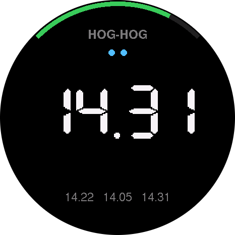<br><sub>HOG-HOG</sub></td><td align="center"><br><sub>SPLIT+H2H</sub></td></tr></table>

## The timing screen

From top to bottom:

- **Battery arc** around the top edge: green, red at 15% or less, blue while charging.
- **Mode name**, then **progress dots**, one per line to tap.
- **Prompt:** `TAP AT BACK LINE` when ready, `NEXT: NEAR HOG` while running, or `TIMED OUT`.
- **The big number.** It runs live in tenths while timing, then shows the final time in hundredths. Times are truncated, not rounded, like any stopwatch.
- **Weight band** label in its colour (for splits), and in SPLIT+H2H the split line.
- **Last 3 results** along the bottom.

<table><tr><td align="center"><br><sub>Ready</sub></td><td align="center">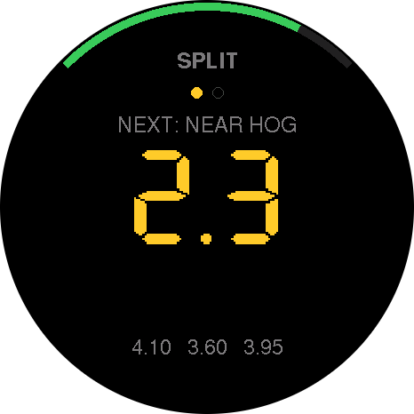<br><sub>Timing</sub></td><td align="center"><br><sub>Result</sub></td><td align="center">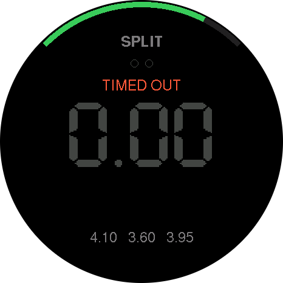<br><sub>Timed out</sub></td></tr></table>

Weight bands, from fastest to slowest split:

<table><tr><td align="center">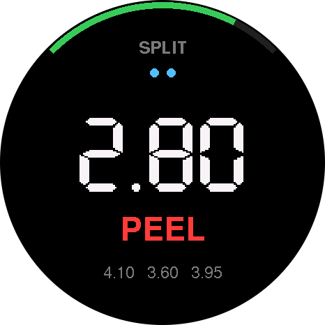<br><sub>PEEL</sub></td><td align="center">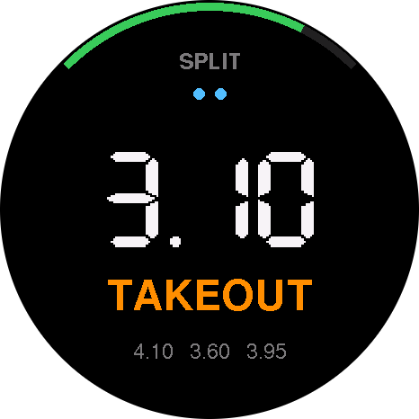<br><sub>TAKEOUT</sub></td><td align="center">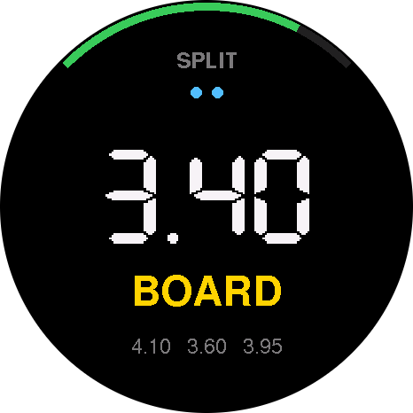<br><sub>BOARD</sub></td><td align="center">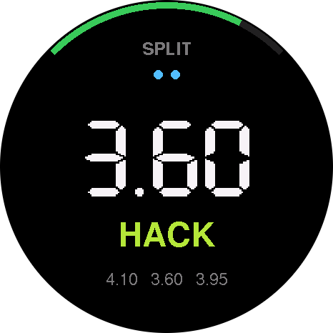<br><sub>HACK</sub></td><td align="center">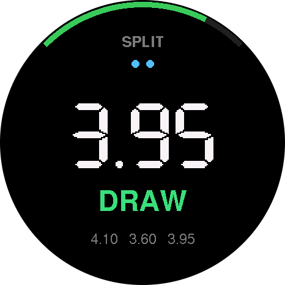<br><sub>DRAW</sub></td><td align="center">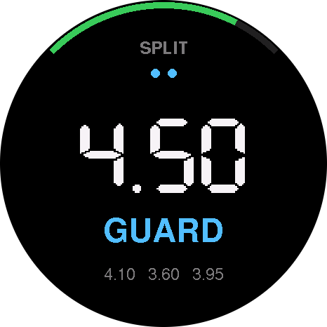<br><sub>GUARD</sub></td></tr></table>

Battery arc: green, red at 15% or less, blue while charging:

<table><tr><td align="center">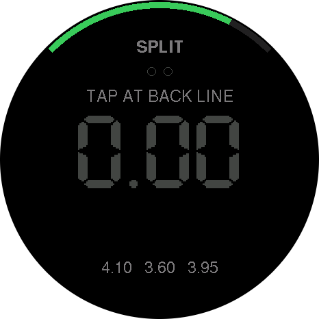<br><sub>80%</sub></td><td align="center">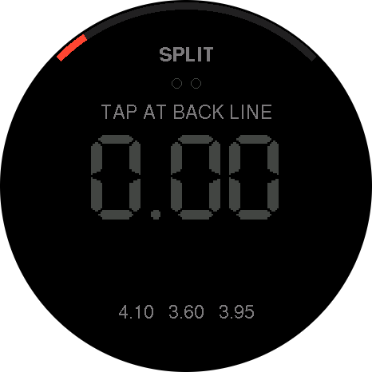<br><sub>12%</sub></td><td align="center">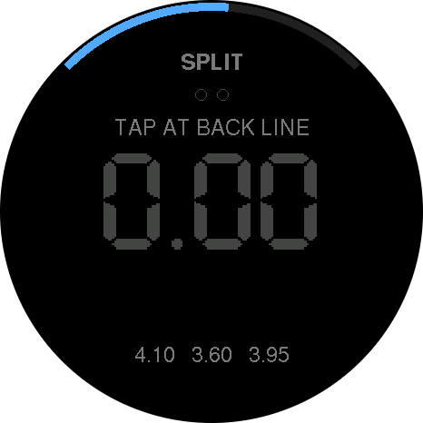<br><sub>Charging</sub></td></tr></table>

## Controls

| Input | Action |
|---|---|
| **Yellow**, tap | Start, then stop, at each line. On the history screen or in the menu, it jumps back **and** starts timing, so a stone is never missed. |
| **Blue**, click | While timing: cancel (false start). On the history screen or in the menu: back. Otherwise: next mode. It acts about 0.3 s after release, while it waits to rule out a double-click. |
| **Blue**, double-click | Open or close the **history screen** |
| **Blue**, hold 2 s | Open the **menu**. Hold again to leave it. |
| **Power**, click / double-click | Reset / power off (hardware) |

## History screen

The last 10 throws, newest at the top.

- **Split** is in the left column, coloured by weight band. **Hog-to-hog** is in the right column.
- A throw timed in SPLIT+H2H shows both on one row. A throw with only one of them shows `-` in the other column.
- The small `#n` is the throw's sequence number, which matches the USB log.

<table><tr><td align="center"><br><sub>History screen</sub></td></tr></table>

## Menu

The menu is for use off the ice. It's the only place the **touchscreen** is used; touch is ignored on the timing and history screens, so gloves and accidental contact can't change anything mid-game.

| Item | What it does |
|---|---|
| **Settings → Brightness** | Drag the slider. The screen changes live. |
| **Settings → Split bands** | Change each band's upper limit with −/+ (0.05 s steps; the limits always stay in order). Drag the list to scroll. **SHIFT ALL**, at the bottom of the list, moves every band together when the ice speed changes. **RESET** restores the defaults. |
| **Export** | Placeholder; coming in a later version. |
| **Clear history** | Asks first, then deletes the stored results. |

<table><tr><td align="center">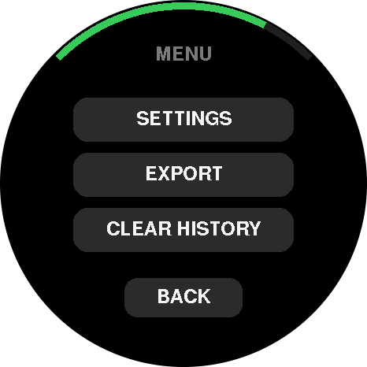<br><sub>Menu</sub></td><td align="center">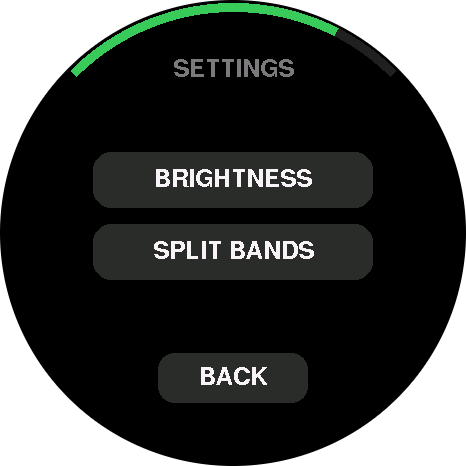<br><sub>Settings</sub></td><td align="center">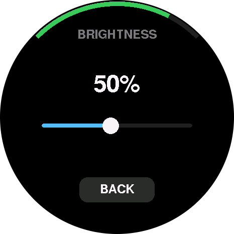<br><sub>Brightness</sub></td></tr></table>

<table><tr><td align="center">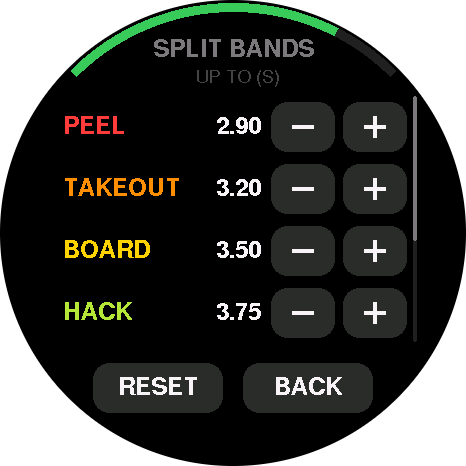<br><sub>Split bands</sub></td><td align="center">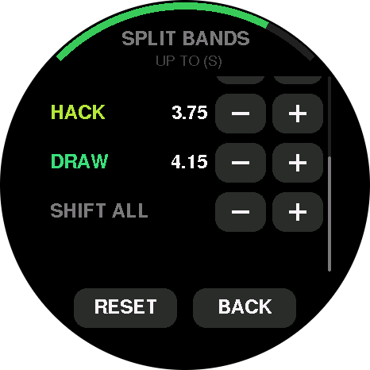<br><sub>Split bands, scrolled to SHIFT ALL</sub></td><td align="center">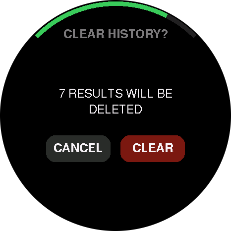<br><sub>Clear history</sub></td></tr></table>

**BACK** on the screen, or a blue click, goes up one level. Settings are saved when you leave a page or the menu, and survive power-off.

## Power saving

"Idle" means no button pressed and no timing run in progress.

| Idle for | What happens | To resume |
|---|---|---|
| 1 min | Screen dims | Any button. A yellow press still counts as a tap. |
| 10 min | **Light sleep:** screen off, everything kept in memory | Any button, instantly. A yellow press **also starts timing**, as if the screen had been on. |
| 30 min | **Deep sleep:** nearly everything off | Either button. The watch restarts in about 1 s with **the history kept**; that press only wakes it. |

**Green status light:** off while awake (the screen shows it's on), a short flash every 5 s in light sleep, and off in deep sleep or when powered off. Double-press the power button to switch off completely; the history is lost then.

Unused hardware (the motion sensor and the Grove port's 5 V output) is kept switched off to save battery.

## USB logging

Connect a serial monitor at 115200 baud and every result is printed as a CSV line (`csv,seq,profile,split_s,hog_to_hog_s,complete`). Details are in the [developer guide](docs/DEVELOPMENT.md#serial-monitor).

## Install

**1. Get the hardware.** You need an [M5Stack StopWatch (C152)](https://shop.m5stack.com/products/m5stack-stopwatch-dev-kit-esp32-s3) from the official M5Stack store. If it's out of stock, M5Stack's [where to buy](https://m5stack.com/distributor) page lists distributors, and the product is also sold through their AliExpress and Amazon shops. No other hardware is needed.

**2. Flash the firmware.** Download `curling-timer-X.Y.Z-merged.bin` from the [latest release](https://github.com/quirkylikthat/curling-stopwatch/releases/latest). Put the watch in download mode (hold the power button about 2 s until the green LED lights), then flash it with [esptool](https://github.com/espressif/esptool), which needs Python 3.10 or newer:

```
pip install esptool
python -m esptool --chip esp32s3 write-flash 0x0 curling-timer-X.Y.Z-merged.bin
```

**On Windows**, `python` may not be found (or may open the Microsoft Store). Use the `py` launcher instead: `py -m pip install esptool`, then `py -m esptool --chip esp32s3 write-flash 0x0 curling-timer-X.Y.Z-merged.bin`. If Python isn't installed, `winget install Python.Python.3.12` installs it (reopen PowerShell afterwards).

esptool looks for the watch by itself. If it reports no port, or finds several, add `--port` with the watch's port (see below), for example `--port COM5`.

**After flashing, the watch does not restart by itself: press the power button to start it.** Flashing replaces the firmware and resets the saved settings (brightness and split bands) to the defaults.

**Finding the serial port.** Plug the watch in with a USB-C **data** cable (some cables only charge), and put it in download mode first.

- **Any system:** run `python -m serial.tools.list_ports -v`. The watch is the entry with `VID:PID=303A:1001` (Espressif USB JTAG/serial). The first column is the port to use.
- **Windows:** open *Device Manager → Ports (COM & LPT)*. The watch appears as *USB Serial Device (COMx)* or *USB JTAG/serial debug unit (COMx)*. Unsure which? Unplug the watch, see which entry disappears, then plug it back in. If no port appears, install M5Stack's [USB driver](https://docs.m5stack.com/en/download).
- **macOS:** run `ls /dev/cu.usbmodem*`. Use the path it prints, such as `/dev/cu.usbmodem1101`.
- **Linux:** run `ls /dev/ttyACM*`. Use the path it prints, usually `/dev/ttyACM0`. If you get a permission error, add yourself to the `dialout` group (`sudo usermod -aG dialout $USER`), then log out and back in.

If the port disappears or flashing fails partway, unplug the watch, put it back in download mode, and try again. To build from source instead, see the [developer guide](docs/DEVELOPMENT.md).

## Documentation

| Document | What's in it |
|---|---|
| [docs/DEVELOPMENT.md](docs/DEVELOPMENT.md) | **Developer guide:** building with VS Code/PlatformIO or the Arduino IDE, flashing, unit tests, checks, tunables, releasing, project layout, known issues |
| [docs/ARCHITECTURE.md](docs/ARCHITECTURE.md) | How the firmware is structured, the decision log (D1–D23) with the reasoning behind each choice, and the on-device test checklist |
| [docs/HARDWARE.md](docs/HARDWARE.md) | Pin map, M5Unified/M5GFX API notes for this board, sleep and wake details, hardware gotchas |
| [docs/PINS.md](docs/PINS.md) | Every pinned version (firmware libraries, CI tools, actions), where it's set, and the monthly review checklist |
| [docs/screenshots](docs/screenshots/index.md) | Every screen as a PNG, rendered from the firmware's own renderer (`make -C tools/screenshots`) |
| [docs/STATUS.md](docs/STATUS.md) | What's verified on the device versus only compiled or unit-tested; known issues and next steps |
| [CHANGELOG.md](CHANGELOG.md) | What changed in each version |
| [AGENTS.md](AGENTS.md) | Rules for anyone changing the code (people or AI): invariants, definition of done, pitfalls |
| [CLAUDE.md](CLAUDE.md) | Points Claude at AGENTS.md |
| [LICENSE](LICENSE), [NOTICE](NOTICE) | PolyForm Noncommercial 1.0.0, and the required attribution line |
| [src/Config.h](src/Config.h) | Every tunable setting, with comments |

## License

Source-available under the [PolyForm Noncommercial License 1.0.0](LICENSE). You're free to build, use, modify and share it for any noncommercial purpose: personal and hobby use, curling clubs, schools, charities and research. If you share it or a modified version, you must keep the license terms and the `Required Notice:` line in [NOTICE](NOTICE), which credits this project.

Commercial use, such as selling devices or firmware, or using it in a paid product or service, needs a separate license. Contact mikesherry@gmail.com.

## Hardware

[M5Stack StopWatch (C152)](https://docs.m5stack.com/en/core/StopWatch): ESP32-S3, 466×466 round AMOLED touchscreen, two buttons (yellow and blue), vibration motor, battery. No other hardware is needed.
