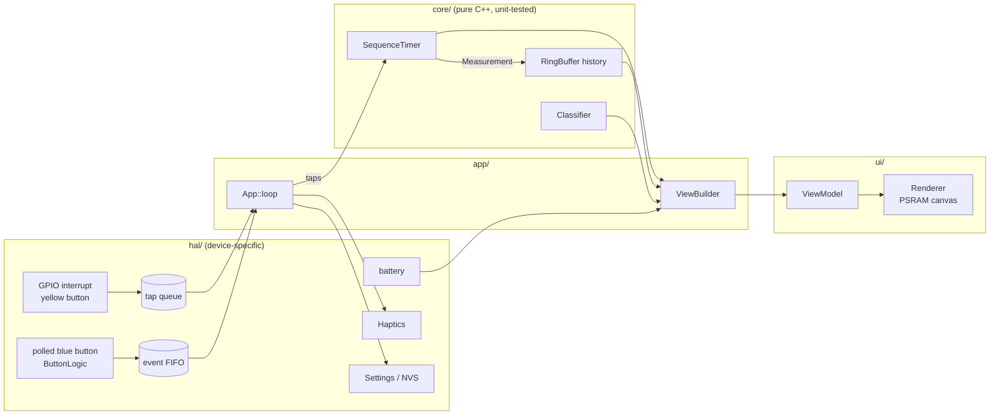

# Architecture & design decisions

This document explains how the firmware is put together and why. Read it before adding features. Add a new entry to the decision log whenever you make a choice that someone (including future you) might later question.

## 1. The shape of the system

| Layer | Folder | May include Arduino/M5? | Job |
|---|---|---|---|
| Core | `src/core/` | **No** | How timing works: state machine, debounce, classification, formatting |
| HAL | `src/hal/` | Yes | How the device does it: GPIO/ISR, vibration, battery, flash |
| UI | `src/ui/` | Yes (Renderer only) | Drawing. `ViewModel.h` itself is pure data |
| App | `src/app/` | `App.cpp` yes, `ViewBuilder.cpp` no | Wiring: route events, decide what's on screen |
| Config | `src/Config.h` | **No** | Every tunable |

The dependency rule: **core depends on nothing**. Everything else may depend on core. `ui/` doesn't know about `app/`, and `hal/` doesn't know about `ui/`.

### One pass of `loop()`

1. `Hardware::update()` runs `M5.update()`, polls the blue button, and refreshes the battery reading every 5 s.
2. Drain events. Taps come from the interrupt queue, each carrying its own timestamp. Clicks and holds come from the FIFO.
3. `SequenceTimer::tick(now)` handles timeouts.
4. A finished measurement is pushed to history and logged to serial as CSV.
5. `Haptics::update()` advances the vibration pattern without blocking.
6. Dim the screen if idle.
7. At most every 33 ms, build a `ViewModel`. If it differs from the last one, render and push the frame.

Nothing blocks. The only `delay()` is the 800 ms splash at boot.

## 2. Decision log

### D1 — Arduino IDE sketch, code under `src/`
**Choice:** a standard sketch (`stopwatch/stopwatch.ino`), with all real code under `src/`.
**Why:** you asked for Arduino IDE. The IDE compiles `src/` recursively and ignores other folders such as `test/` and `docs/`, so we get a normal multi-file C++ project without a build system. The `.ino` stays three lines long, so the IDE's `.ino` preprocessing (auto-prototypes) can't surprise us.
**Revisit if:** you want CI builds, pinned library versions, or faster incremental compiles. PlatformIO is the next step, and M5Stack publishes a ready `platformio.ini` for this board on the product page.

### D2 — Pure "core" layer, unit-tested on the PC
**Choice:** the timing state machine, debounce logic, band classification, formatting and screen-content logic have no Arduino or M5 includes. Time is always passed in as a parameter; core never reads a clock.
**Why:**
- Timing correctness is the product. A 30-test suite runs in under a second on a laptop (`make -C test`), with no flashing and no device.
- M5Unified has broken APIs on this board before (0.2.21 changed the IO-expander API). Keeping device calls in `hal/` and `ui/` contains that churn.
- Fake timestamps make edge cases trivial to test: bounce, timeouts, `millis()` wrap, ISR-vs-loop clock skew.

### D3 — The timing button is timestamped in an interrupt
**Choice:** the yellow button's press edge fires a GPIO interrupt. The handler records `esp_timer_get_time()` (µs, 64-bit) and pushes it to a FreeRTOS queue. The main loop consumes taps later, but the timestamp is already fixed.
**Why:** pushing a full 466×466 frame takes roughly 20–30 ms. With polling, every tap would pick up 0–30 ms of random error depending on where in the frame the loop was. Hand timing already carries about ±0.05 s of human error per tap, and on keen ice 0.1 s of split error is about 6 ft at draw weight ([Paulley & Newhook](https://glennpaulley.ca/curling/2024/09/17/ten-reasons-why-an-interval-time-might-be-inaccurate/)). The device shouldn't add to that budget. The interrupt gives sub-millisecond capture, and rendering cost becomes irrelevant to accuracy.
**Safety valve:** `config::kUseInterruptTiming = false` switches to polling if the interrupt misbehaves on your hardware revision.

### D4 — One button for both start and stop
**Choice:** every gate (back line, near hog, far hog) is a tap of the same yellow button.
**Why:** your reaction delay is roughly the same at both ends of an interval, so most of it cancels out. Different buttons or fingers would have different delays, and that adds error. It also means you can time by feel without looking.

### D5 — We read the button GPIOs ourselves
**Choice:** G2 (yellow) and G1 (blue) are read directly. The pins are in `Config.h`. We don't use `M5.BtnA` / `M5.BtnB`.
**Why:** timing must not depend on M5Unified's button mapping or update rate. `ButtonLogic` (debounce, click, hold) is pure, so it is unit-tested. `M5.update()` is still called for touch and power.

### D6 — Modes are data: "gate sequences"
**Choice:** a `TimingProfile` is a list of gates (lines the stone crosses) plus a min/max sanity window per interval. Split, hog-to-hog and the combined mode are three rows in `config::kProfiles`. They are not three classes.
**Why:** adding *tee-to-hog*, or any other N-tap timing, is a one-line change, and one well-tested state machine serves all of them. The min/max windows do real work: taps faster than physically plausible are ignored, and a forgotten second tap times out instead of leaving a stale run.
**Timeout behaviour:** if nothing has been captured, the timer returns to Ready ("TIMED OUT"). If at least one interval has been captured, the partial result is kept. Example: in the combined mode, a hogged stone gives a split but never reaches the far hog.

### D7 — Layered protection against false taps
1. **Interrupt lockout (150 ms):** absorbs contact bounce at the moment of the press.
2. **Global minimum tap gap (0.4 s):** absorbs release bounce, and stops a sloppy double-tap at the hog line from starting a new run.
3. **Per-interval minimum (split 1.5 s, hog-to-hog 5 s):** rejects anything physically implausible.

All three are configurable, and layers 2–3 are unit-tested.

### D8 — Screen = f(state), redrawn only on change
**Choice:** `ViewBuilder` turns state into a plain `ViewModel` struct. The `Renderer` draws the whole struct into a PSRAM off-screen canvas, then pushes it in one go. The app compares each new model with the previous one and skips identical frames. Frames are capped at about 30 fps.
**Why:**
- No flicker, because there are no partial redraws.
- No wasted work: while timing, the live value shows tenths, so it changes about 10 times a second. At rest, nothing redraws.
- "What's on screen" is pure logic, so it is unit-tested.
- The Renderer stays dumb and easy to restyle.

The live value shows tenths because hundredths flicker unreadably. Final results show hundredths.

### D9 — Haptics first, sound off
**Choice:** every accepted tap gives a short buzz, a result gives a double buzz, and a cancel or timeout gives a long buzz. The speaker is off by default (`kBeepEnabled`).
**Why:** you're watching the stone, not the screen. A buzz confirms the device registered the tap without you looking at it. Beeps carry across the sheet and bother other people.

### D10 — No heap allocation, no `String`, after boot
**Choice:** fixed-size buffers everywhere: `RingBuffer`, `EventFifo`, `char[]`.
**Why:** this device should run all evening without fragmenting memory or stuttering. The only large allocation is the canvas, made once at boot.

### D11 — `Config.h` is the only file you edit to tune behaviour
Pins, modes, sanity windows, weight bands, haptic durations, brightness and timeouts all live in `Config.h`. **The split bands are placeholders.** As a reference point, a ~3.8 s split corresponds to a ~14.3 s hog-to-hog on nominal ice, and Olympic draws ran ~4.1 s / ~15 s on very keen ice ([Paulley, 2026](https://glennpaulley.ca/curling/2026/07/06/mapping-delivery-split-times-to-hog-to-hog-times/)). Calibrate on your own sheets.

### D12 — Serial CSV as the first data path
Each result prints `csv,seq,profile,split_s,hog_to_hog_s,complete`. That gives you logging and analysis (capture it in the Serial Monitor and paste it into a spreadsheet) before committing to Wi-Fi, BLE or on-device storage.

### D13 — Persist settings, keep history in RAM (for now)
The current mode is saved to NVS flash, and only when it changes. The 32-entry history lives in RAM and clears on reset. Persisting it is easy to add later, but it raises "per game? per session?" questions we should answer first.

### D14 — Truncate, don't round
3.829 s displays as 3.82. That's the stopwatch convention: never display time that hasn't elapsed yet.

### D15 — AMOLED care
Black background (black pixels are off, which saves battery), dim colours for static elements, and the screen dims after 60 s idle to reduce burn-in. Any input wakes it, **and a timing tap is still counted**, because the stone is already moving.

## 3. How to extend

| You want to… | Do this |
|---|---|
| Add a tap-sequence mode (e.g. tee-to-hog) | Add a row to `kProfiles` in `Config.h`. Add a test. |
| Add a new kind of interval | Add to `IntervalKind`, then to `intervalName()` and `bandFor()` in `ViewBuilder.cpp`. |
| Tune what counts as DRAW, etc. | Edit `kSplitBands` / `kHogToHogBands`. |
| Add touch gestures (e.g. swipe for history) | Add an `InputType`. Produce it in `Hardware::update()` from `M5.Touch.getDetail()`. Handle it in `App::handle()`. |
| Add a non-tap feature (game / thinking clock) | **This is the moment to add a `Mode` interface** (`onEvent`, `tick`, `buildView`), with `App` holding a list of modes. One mode doesn't justify the abstraction; two very different ones do. |
| Save history across power cycles | New `hal/Storage` (NVS or LittleFS). App pushes to it in `onMeasurement()`. |
| Deep sleep | Use M5PM1 wake-on-button. See `HARDWARE.md`. |

## 4. First-flash validation checklist

The pins and polarity were confirmed from the M5Unified source. These can only be confirmed on the device:

1. **Boot log.** Serial (115200) should print `board=... timing=isr idle levels: yellow=1 blue=1`.
2. **Tap on press, not release.** Hold the yellow button down for a second. The buzz should come when you press, not when you let go.
3. **Buttons.** Yellow should time and blue should change mode.
4. **Canvas.** There should be no `[ui] canvas alloc failed` message, and no visible flicker.
5. **Accuracy sanity check.** Time about 10 s against a phone stopwatch using taps.
6. **Battery arc.** It should show at the top, and turn blue while charging.

## 5. Roadmap ideas (to discuss)

- **Tee-to-hog** split profile (one line in Config).
- **Predicted hog-to-hog from a split**, using a constant-deceleration model with one calibrated "ice" constant (Sonobe et al. 2024, summarised by Paulley).
- **Ice-speed tracker:** running average of draw hog-to-hogs, per end and per direction (the two ends can differ).
- **Game / thinking clock** per team, with timeouts.
- **Tagging shots** by player, end or shot type using touch. A history screen.
- **Export** over Wi-Fi or BLE to a phone or spreadsheet.
- **Deep sleep** and wake on button via M5PM1.
