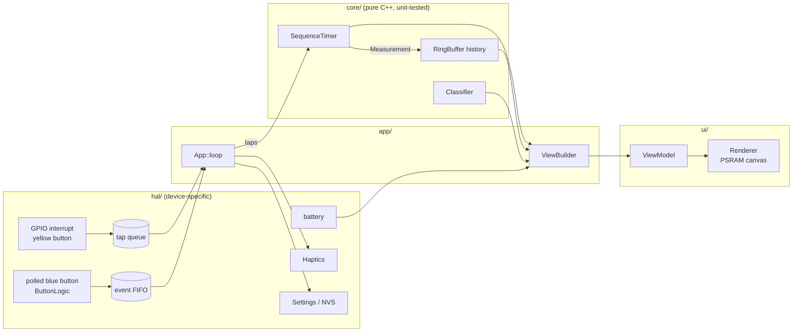

# Architecture & design decisions

This document explains how the firmware is put together and why. Read it before adding features. Add a new entry to the decision log whenever you make a choice that someone (including future you) might later question.

The rules every change must follow are in [`AGENTS.md`](../AGENTS.md): the invariants and the definition of done. What has actually been verified on the device is in [`STATUS.md`](STATUS.md).

## 1. The shape of the system

| Layer | Folder | May include Arduino/M5? | Job |
|---|---|---|---|
| Core | `src/core/` | **No** | How timing works: state machine, debounce, classification, formatting |
| HAL | `src/hal/` | Yes | How the device does it: GPIO/ISR, vibration, battery, flash |
| UI | `src/ui/` | Yes (Renderer only) | Drawing. `ViewModel.h` itself is pure data |
| App | `src/app/` | `App.cpp` yes, `ViewBuilder.cpp` no | Wiring: route events, decide what's on screen |
| Config | `src/Config.h` | **No** | Every tunable |

The dependency rule: **core depends on nothing**. Everything else may depend on core. `ui/` doesn't know about `app/`, and `hal/` doesn't know about `ui/`.

### One pass of `loop()`

1. `Hardware::update()` runs `M5.update()`, polls the blue button, and refreshes the battery reading every 5 s.
2. Drain events. Taps come from the interrupt queue, each carrying its own timestamp. Clicks and holds come from the FIFO.
3. `SequenceTimer::tick(now)` handles timeouts.
4. A finished measurement is pushed to history and logged to serial as CSV.
5. `Haptics::update()` advances the vibration pattern without blocking.
6. Dim the screen if idle.
7. At most every 33 ms, build a `ViewModel`. If it differs from the last one, render and push the frame.

Nothing blocks. The only `delay()` is the 800 ms splash at boot.

## 2. Decision log

### D1 — Arduino IDE sketch, code under `src/`
**Choice:** a standard sketch (`stopwatch/stopwatch.ino`), with all real code under `src/`.
**Why:** you asked for Arduino IDE. The IDE compiles `src/` recursively and ignores other folders such as `test/` and `docs/`, so we get a normal multi-file C++ project without a build system. The `.ino` stays three lines long, so the IDE's `.ino` preprocessing (auto-prototypes) can't surprise us.
**Update (v0.1.0):** PlatformIO was added alongside the IDE, not instead of it. See D16.

### D2 — Pure "core" layer, unit-tested on the PC
**Choice:** the timing state machine, debounce logic, band classification, formatting and screen-content logic have no Arduino or M5 includes. Time is always passed in as a parameter; core never reads a clock.
**Why:**
- Timing correctness is the product. A 57-test suite runs in under a second on a laptop (`make -C test`), with no flashing and no device.
- M5Unified has broken APIs on this board before (0.2.21 changed the IO-expander API). Keeping device calls in `hal/` and `ui/` contains that churn.
- Fake timestamps make edge cases trivial to test: bounce, timeouts, `millis()` wrap, ISR-vs-loop clock skew.

### D3 — The timing button is timestamped in an interrupt
**Choice:** the yellow button's press edge fires a GPIO interrupt. The handler records `esp_timer_get_time()` (µs, 64-bit) and pushes it to a FreeRTOS queue. The main loop consumes taps later, but the timestamp is already fixed.
**Why:** pushing a full 466×466 frame takes roughly 20–30 ms. With polling, every tap would pick up 0–30 ms of random error depending on where in the frame the loop was. Hand timing already carries about ±0.05 s of human error per tap, and on keen ice 0.1 s of split error is about 6 ft at draw weight ([Paulley & Newhook](https://glennpaulley.ca/curling/2024/09/17/ten-reasons-why-an-interval-time-might-be-inaccurate/)). The device shouldn't add to that budget. The interrupt gives sub-millisecond capture, and rendering cost becomes irrelevant to accuracy.
**Safety valve:** `config::kUseInterruptTiming = false` switches to polling if the interrupt misbehaves on your hardware revision.

### D4 — One button for both start and stop
**Choice:** every gate (back line, near hog, far hog) is a tap of the same yellow button.
**Why:** your reaction delay is roughly the same at both ends of an interval, so most of it cancels out. Different buttons or fingers would have different delays, and that adds error. It also means you can time by feel without looking.

### D5 — We read the button GPIOs ourselves
**Choice:** G2 (yellow) and G1 (blue) are read directly. The pins are in `Config.h`. We don't use `M5.BtnA` / `M5.BtnB`.
**Why:** timing must not depend on M5Unified's button mapping or update rate. `ButtonLogic` (debounce, click, hold) is pure, so it is unit-tested. `M5.update()` is still called for touch and power.

### D6 — Modes are data: "gate sequences"
**Choice:** a `TimingProfile` is a list of gates (lines the stone crosses) plus a min/max sanity window per interval. Split, hog-to-hog and the combined mode are three rows in `config::kProfiles`. They are not three classes.
**Why:** adding *tee-to-hog*, or any other N-tap timing, is a one-line change, and one well-tested state machine serves all of them. The min/max windows do real work: taps faster than physically plausible are ignored, and a forgotten second tap times out instead of leaving a stale run.
**Timeout behaviour:** if nothing has been captured, the timer returns to Ready ("TIMED OUT"). If at least one interval has been captured, the partial result is kept. Example: in the combined mode, a hogged stone gives a split but never reaches the far hog.

### D7 — Layered protection against false taps
1. **Interrupt lockout (150 ms):** absorbs contact bounce at the moment of the press.
2. **Global minimum tap gap (0.4 s):** absorbs release bounce, and stops a sloppy double-tap at the hog line from starting a new run.
3. **Per-interval minimum (split 1.5 s, hog-to-hog 5 s):** rejects anything physically implausible.

All three are configurable, and layers 2–3 are unit-tested.

### D8 — Screen = f(state), redrawn only on change
**Choice:** `ViewBuilder` turns state into a plain `ViewModel` struct. The `Renderer` draws the whole struct into a PSRAM off-screen canvas, then pushes it in one go. The app compares each new model with the previous one and skips identical frames. Frames are capped at about 30 fps.
**Why:**
- No flicker, because there are no partial redraws.
- No wasted work: while timing, the live value shows tenths, so it changes about 10 times a second. At rest, nothing redraws.
- "What's on screen" is pure logic, so it is unit-tested.
- The Renderer stays dumb and easy to restyle.

The live value shows tenths because hundredths flicker unreadably. Final results show hundredths.

**Vertical spacing** is computed from the fonts' measured *ink* (lit pixels), not hard-coded Y values (`ui/Layout.h`, unit-tested). Any lines between the big number and the history row (the band label and/or the secondary line) get equal gaps. LovyanGFX's `middle_center` centres a font's whole line box, including its tallest and lowest glyphs, so caps don't land where you'd guess. Re-measure with `scripts/fontmetrics.py` if fonts or sizes change.

### D9 — Haptics first, sound off
**Choice:** every accepted tap gives a short buzz, a result gives a double buzz, and a cancel or timeout gives a long buzz. The speaker is off by default (`kBeepEnabled`).
**Why:** you're watching the stone, not the screen. A buzz confirms the device registered the tap without you looking at it. Beeps carry across the sheet and bother other people.

### D10 — No heap allocation, no `String`, after boot
**Choice:** fixed-size buffers everywhere: `RingBuffer`, `EventFifo`, `char[]`.
**Why:** this device should run all evening without fragmenting memory or stuttering. The only large allocation is the canvas, made once at boot.

### D11 — `Config.h` is the only file you edit to tune behaviour
Pins, modes, sanity windows, weight bands, haptic durations, brightness and timeouts all live in `Config.h`. **The split bands are placeholders.** As a reference point, a ~3.8 s split corresponds to a ~14.3 s hog-to-hog on nominal ice, and Olympic draws ran ~4.1 s / ~15 s on very keen ice ([Paulley, 2026](https://glennpaulley.ca/curling/2026/07/06/mapping-delivery-split-times-to-hog-to-hog-times/)). Calibrate on your own sheets.

### D12 — Serial CSV as the first data path
Each result prints `csv,seq,profile,split_s,hog_to_hog_s,complete`. That gives you logging and analysis (capture it in the Serial Monitor and paste it into a spreadsheet) before committing to Wi-Fi, BLE or on-device storage.

### D13 — Persist settings, keep history in RAM (for now)
The current mode is saved to NVS flash, and only when it changes. The 32-entry history lives in RAM and clears on reset. Persisting it is easy to add later, but it raises "per game? per session?" questions we should answer first.

### D14 — Truncate, don't round
3.829 s displays as 3.82. That's the stopwatch convention: never display time that hasn't elapsed yet.

### D15 — AMOLED care
Black background (black pixels are off, which saves battery), dim colours for static elements, and the screen dims after 60 s idle to reduce burn-in. Any input wakes it, **and a timing tap is still counted**, because the stone is already moving.

### D16 — Two toolchains, one source tree (Arduino IDE + PlatformIO)
**Choice:** keep the Arduino sketch layout, and add a `platformio.ini` that builds the *same* `stopwatch.ino` + `src/`. PlatformIO is the recommended day-to-day tool. The Arduino IDE remains a fully supported fallback.
**Why:** the Arduino IDE never limited what the firmware can do. It limited the workflow: no version pinning, board settings stored in menus rather than the repo, no integrated tests, and a weak editor. PlatformIO fixes all four without touching the code.
**How it's wired:**
- `src_dir = .` points PlatformIO at the sketch root, and `build_src_filter` picks the files each environment needs. PlatformIO converts `stopwatch.ino` to a temporary `stopwatch.ino.cpp` during the build, which is why the filter says `+<*.ino.cpp>`.
- **Platform: pioarduino 55.03.39**, not PlatformIO's official `espressif32`. The official platform stopped at Arduino-ESP32 2.x. pioarduino is the community-maintained 3.x platform, and release 55.03.39 is Arduino-ESP32 3.3.9, the same core as M5Stack's board package 3.3.9. Matching cores means both toolchains behave identically. M5Stack's sample `platformio.ini` uses the older 2.x platform, so we deliberately don't follow it.
- **Board: `boards/m5stack-stopwatch.json`.** Neither PlatformIO platform ships a StopWatch board. The JSON mirrors the IDE defaults: OPI PSRAM (`qio_opi`), 16 MB flash, 3 MB app partition, USB CDC on boot, `-DARDUINO_M5STACK_STOPWATCH`. OPI PSRAM matters beyond our canvas, because M5GFX checks it at compile time for correct AMOLED rendering.
- **Variant: `variants/m5stack_stopwatch/`.** Upstream Arduino-ESP32 has no StopWatch pin map yet, so we carry M5Stack's copy. That keeps `SDA`/`SCL` and friends identical to the IDE build, which matters once we use Port A. Six macros that `Arduino.h` redefines anyway were dropped to silence about 400 warnings per build.
- **Versions pinned:** M5Unified 0.2.25, M5GFX 0.2.32. Upgrade deliberately, then run tests plus the device checklist.
- **`[env:native]`** builds the same host tests as `make -C test`. `scripts/pio_tests.py` adds a "Run unit tests" task to the sidebar. A failing test fails the task, so this is ready for CI later.

**Verified (Oct 2026):** both toolchains build with zero warnings from our code, and the native tests pass. The flash size differs slightly (IDE 602 KB, PlatformIO 644 KB) because of link details in the two platform packages. It is not a code difference.
**Revisit if:** we need ESP-IDF settings that Arduino's prebuilt core fixes. pioarduino can also build with `framework = arduino, espidf` and a custom `sdkconfig`, so that path stays open without changing tools again.

### D17 — Three-stage power saving: dim → light sleep → deep sleep
**Choice:** idle (no button, no run in progress) for 1 min dims the screen, 10 min enters ESP32 **light sleep**, and 30 min enters ESP32 **deep sleep**. The pure `PowerPolicy` decides the stage, the `App` acts on it, and the `Hardware` class does the chip work.

**Light sleep:**
- *What sleeps:* CPU paused, RAM and PSRAM kept, AMOLED in panel sleep-in.
- *How it wakes:* GPIO level wake on either button, plus a timer set to fire when deep sleep is due.
- *What a wake press does:* yellow resumes in about 1 ms and **counts as the first gate**. Blue only wakes.
- *State kept:* everything, because execution simply continues.

**Deep sleep:**
- *What sleeps:* everything except the RTC domain. The AMOLED is put to sleep first.
- *How it wakes:* EXT1 "any low" on G1/G2. Both are RTC-capable pins with external pull-ups.
- *What a wake press does:* only wakes the device, which reboots in about 1 s.
- *State kept:* history and the sequence counter go in RTC memory. The mode is already saved in NVS.

**Why:**
- **Light sleep first.** It resumes instantly, so you can't miss a stone after a long gap. Deep sleep saves more but needs a reboot. Two stages get most of the battery benefit without hurting the "pick it up and time" experience.
- **The yellow wake press counts as a tap.** Otherwise your *next* tap, at the hog line, would *start* a run instead of ending one, which gives a bogus or timed-out split. The wake timestamp is late by the wake-up latency (about 1 ms, well under human error).
- **Deep sleep is reached through a timer wake from light sleep.** It happens without ever lighting the screen, because the CPU can't count idle time while paused.
- **History survives deep sleep but not power-off.** A checksummed snapshot is packed into an RTC-memory byte array just before sleeping, and restored once after an EXT1 wake. Every other kind of boot discards it, so a reset never resurrects old data. The pack/unpack logic is pure and unit-tested.
- **The wake press never also acts.** `ButtonLogic::suppressUntilRelease()` swallows the blue press that woke the device, or a button held during boot, so it doesn't change the mode.
- **The timing interrupt is detached during light sleep.** GPIO wake reprograms the pin to level-triggered, which would fight the edge interrupt. It's re-attached on wake.

**Not done (yet):**
- Cutting the L3B rail (display, audio, motor) or touch power during deep sleep. M5Unified's own `deepSleep()` doesn't do this either, and the pin docs disagree on which IO-expander pin is which.
- Using the M5PM1's true power-off. That draws less, but only the power button can wake it.
- Measuring the current in each state. All three are worth doing once there's a meter on the bench.

### D18 — Green LED means "asleep" *(LED behaviour revised by D20)*
**Choice (original):** the status LED is **off while awake** and **green during light and deep sleep**. Powered off is dark. D20 changed this to a flash in light sleep and off in deep sleep.
**Why:** Mike asked for a yellow "asleep" light, but `LED1` is green-only on the power chip's `LED_EN` pin. The options considered were:
- **LED off while asleep.** This matches the old behaviour, where the LED was always on. The drawback is that asleep then looks identical to powered off.
- **A yellow on-screen indicator.** This would keep the AMOLED powered and defeat the sleep savings.
- **Green only while asleep.** This was chosen: each of the three states (awake, asleep, off) is distinguishable at a glance.

It costs no CPU, because the M5PM1 holds the LED state while the ESP32 sleeps.
**Revisit if:** the LED draws more in deep sleep than it's worth once sleep current is measured. In that case, blink it from a periodic light-sleep wake, or drop it.

### D19 — History screen on a blue double-click
**Choice:** a second screen lists the last 10 throws (`kHistoryScreenRows`), newest first.
- **Columns:** split on the left, coloured by weight band; hog-to-hog on the right.
- **A throw is one `Measurement`.** A SPLIT+H2H throw puts both values on the same row, and a single-interval throw shows `-` in the other column.
- **The `#n` is the sequence number,** so rows match the serial CSV.

Navigation:
- **Blue double-click** toggles the screen.
- **Blue click** on the history screen means *back*. It does not also change the mode.
- **Yellow** jumps back *and* is processed as a timing tap.
- **Light sleep** always wakes to the timing screen.

**Why:**
- **Buttons, not touch.** Capacitive touch doesn't work through curling gloves. The cost of a double-click is that every single blue click is delayed by the double-click window (300 ms; tuned on the device from 350 ms), because `ButtonLogic` waits to rule out a second press. A blue hold was already taken (clear history).
- **Yellow never gets swallowed.** That follows invariant 7, and a stone may be moving when you glance at the history.
- **Same `ViewModel`/`Renderer` path, with a `Screen::History` case.** One dirty-check and one canvas push serve both screens. The history view doesn't depend on the live timer, so a run in progress causes no redraws while you're on it.
- **Rows come straight from the 32-entry RAM history,** which is restored after deep sleep. No new storage was needed.

**Revisit if:** Mike wants more than 10 rows. That needs scrolling (a yellow/blue page action), or a smaller font at the cost of readability. Also revisit if the single-click delay feels sluggish on the ice; shortening `kControlDoubleClickMs` makes the double-click harder to hit.

### D20 — Power trims: unused hardware off, idle the CPU, flash the LED
**Choice:** four changes. All are switchable in `Config.h`, and none are measured yet.

| Change | Setting | Expected saving |
|---|---|---|
| Hold the **BMI270 IMU in suspend** (we don't use it) | `kImuEnabled = false` | ~0.7 mA, in every state |
| Keep the **Grove port 5 V booster off** (nothing plugged in) | `kGrovePortPower = false` | Unknown, probably 0.1–1 mA |
| **1 ms idle per `loop()`**, so the CPU core can enter WAITI instead of spinning at 240 MHz | `kLoopIdleMs = 1` | Likely tens of mA while awake |
| Status LED **flashes 50 ms every 5 s in light sleep**, and is **off in deep sleep** | `kStatusLedLightSleep`, `kStatusLedInDeepSleep` | ~0.5 mA asleep, versus the solid LED of D18 |

**Why:**
- **IMU and booster:** M5Unified's defaults (`internal_imu`, `output_power`) switch both on, and we use neither. The BMI270 is on the always-on L1 rail, so a reboot doesn't reset it. `Hardware::suspendImu()` therefore writes suspend explicitly (PWR_CTRL = 0, PWR_CONF = adv_power_save) rather than just not starting it.
- **The loop pause** keeps timing accuracy intact, because taps are timestamped in the ISR. The pause only delays *handling* by about 1 ms. This refines invariant 4: no blocking delays except this deliberate idle yield.
- **The LED flash** comes from timer wake-ups inside `Hardware::lightSleep()`. Each wake turns the LED on, light-sleeps for 50 ms with it lit, then turns it off. That's two wakes of a few ms per flash, roughly 0.07 mA on average. The caller (App) only sees button, deadline, or rejected-sleep wakes.
- **Why not flash in deep sleep:** each wake from deep sleep is a ~1 s reboot. The ULP coprocessor can't reach the M5PM1 (its I²C pins G47/48 aren't RTC GPIOs). So the LED is off in deep sleep. The trade-off is that deep sleep then looks the same as powered off.

**Not done (yet):**
- Putting the touch controller to sleep and stopping M5Unified's touch polling.
- Re-enabling the M5PM1/M5IOE1 I²C idle sleep. M5Stack disabled it deliberately, because the first message after waking is lost.
- A lower CPU frequency.

**Revisit if:** measurements show different priorities.

## 3. How to extend

| You want to… | Do this |
|---|---|
| Add a tap-sequence mode (e.g. tee-to-hog) | Add a row to `kProfiles` in `Config.h`. Add a test. |
| Add a new kind of interval | Add to `IntervalKind`, then to `intervalName()` and `bandFor()` in `ViewBuilder.cpp`. |
| Tune what counts as DRAW, etc. | Edit `kSplitBands` / `kHogToHogBands`. |
| Add another screen | Add a `ViewModel::Screen` value. Have `ViewBuilder` fill it, with a unit test. Add a `Renderer` draw function. Add an `App` flag/state and the navigation in `App::handle()`. Copy the history screen (D19). |
| Add touch gestures | Add an `InputType`. Produce it in `Hardware::update()` from `M5.Touch.getDetail()`. Handle it in `App::handle()`. |
| Add a non-tap feature (game / thinking clock) | **This is the moment to add a `Mode` interface** (`onEvent`, `tick`, `buildView`), with `App` holding a list of modes. One mode doesn't justify the abstraction; two very different ones do. |
| Save history across power cycles | New `hal/Storage` (NVS or LittleFS). App pushes to it in `onMeasurement()`. |
| Change sleep timing / behaviour | `Config.h` power section. The policy is in `core/PowerPolicy`, and the chip work in `Hardware::lightSleep()` / `deepSleep()`. |

## 4. First-flash validation checklist

The pins and polarity were confirmed from the M5Unified source. These can only be confirmed on the device:

1. **Boot log.** Serial (115200) should print `board=... timing=isr idle levels: yellow=1 blue=1`.
2. **Tap on press, not release.** Hold the yellow button down for a second. The buzz should come when you press, not when you let go.
3. **Buttons.** Yellow should time and blue should change mode.
4. **Canvas.** There should be no `[ui] canvas alloc failed` message, and no visible flicker.
5. **Accuracy sanity check.** Time about 10 s against a phone stopwatch using taps.
6. **Battery arc.** It should show at the top, and turn blue while charging.
7. **Sleep.** Set the power times in `Config.h` to 20 s / 40 s / 80 s for this test, then:
   - Leave the device idle. It should dim, then the screen should go off: serial shows `[power] light sleep`.
   - Press **blue**. It should wake instantly without changing mode.
   - Let it light-sleep again, then tap **yellow**, then tap again about 4 s later. That should give a normal split.
   - Leave it idle past 80 s. Serial shows `[app] deep sleep, N results saved`.
   - Press either button. It should reboot without the splash, and the history row should still show your results.
   - Put the times back afterwards.
8. **Status LED (D20).**
   - Screen on: off.
   - Light sleep: a short flash about every 5 s.
   - Pressing a button during or between flashes should wake the device instantly, with the LED off.
   - Deep sleep: off.
   - After a double-press power-off: dark.
9. **History screen.** Time a few throws in each mode, including one SPLIT+H2H. Then:
   - **Double-click blue.** The history screen should show the throws newest first. The SPLIT+H2H throw should have both values on one row, and the others should show `-`.
   - **Check the edges.** All 10 rows and the footer should sit fully inside the round screen.
   - **Single-click blue.** It should go back without changing the mode.
   - **Re-open the history screen and tap yellow.** It should jump back with the timer running. Tap again for a normal result.
   - **Single click on the timing screen.** It should still change mode, about 0.3 s after release.
10. **Power trims (D20).**
    - The boot log shouldn't show `[hw] IMU suspend failed`.
    - Timing, buttons, haptics and the live display should feel the same as before the 1 ms loop pause.
    - Optional, with an inline USB meter on a fully charged device: compare the current awake, in light sleep and in deep sleep against the old firmware.

## 5. Roadmap ideas (to discuss)

- **Tee-to-hog** split profile (one line in Config).
- **Predicted hog-to-hog from a split**, using a constant-deceleration model with one calibrated "ice" constant (Sonobe et al. 2024, summarised by Paulley).
- **Ice-speed tracker:** running average of draw hog-to-hogs, per end and per direction (the two ends can differ).
- **Game / thinking clock** per team, with timeouts.
- **Tagging shots** by player, end or shot type using touch. A history screen.
- **Export** over Wi-Fi or BLE to a phone or spreadsheet.
- **Measure sleep current** and decide whether to cut the L3B rail, or use M5PM1 power-off, after a longer idle period.
