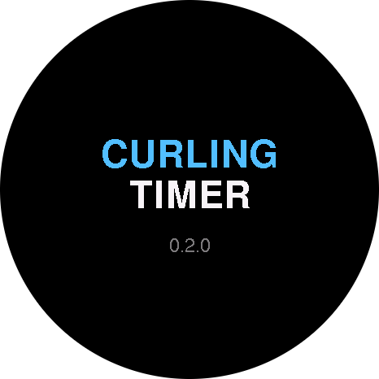
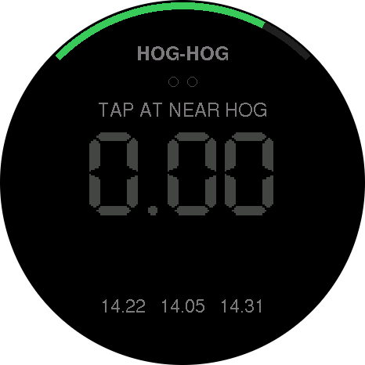
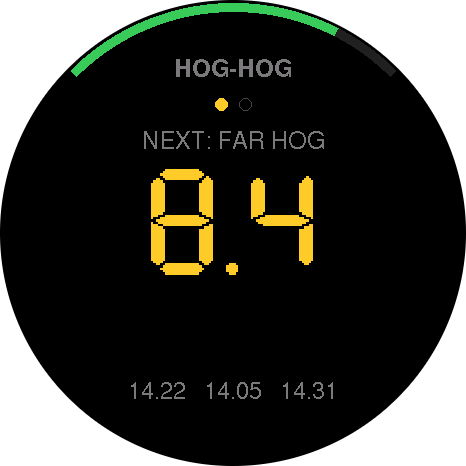
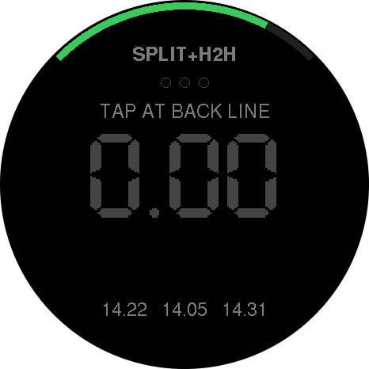
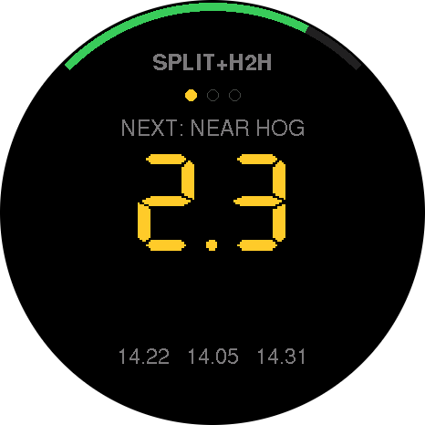
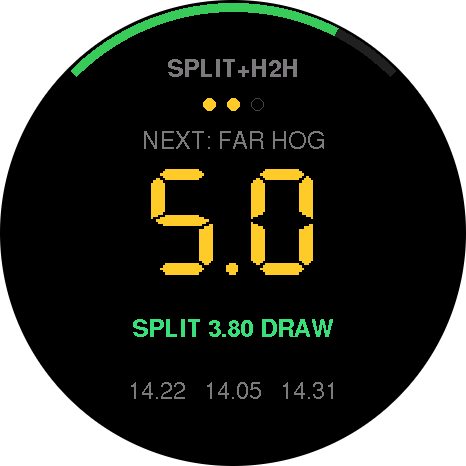
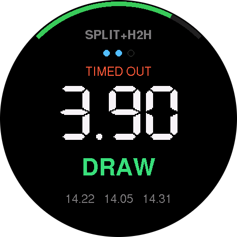
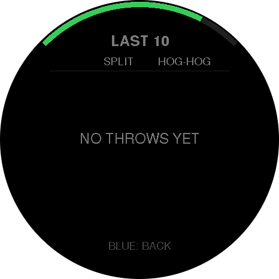
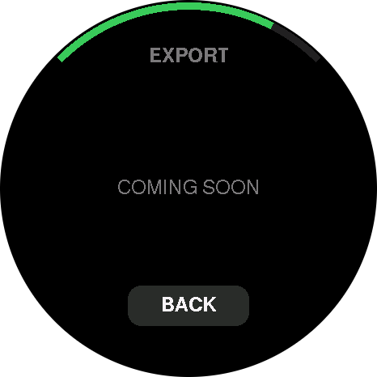

# Screenshots

Generated by `make -C tools/screenshots`; do not edit by hand. Each image is the 466x466 framebuffer the firmware's `Renderer` draws for that state, not a photo of the AMOLED. The corners are transparent, like the round glass.

## Boot

  
`splash.png`: Boot splash

## Timing modes / The timing screen

  
`split-ready.png`: SPLIT: ready, waiting for the first tap

  
`split-running.png`: SPLIT: timing, live value

  
`split-result.png`: SPLIT: result

  
`hogHog-ready.png`: HOG-HOG: ready, waiting for the first tap

  
`hogHog-running.png`: HOG-HOG: timing, live value

  
`hogHog-result.png`: HOG-HOG: result

  
`both-ready.png`: SPLIT+H2H: ready, waiting for the first tap

  
`both-running.png`: SPLIT+H2H: timing, live value

  
`both-running-h2h.png`: SPLIT+H2H: near hog tapped; hog-to-hog running, split shown below with its band

  
`both-result.png`: SPLIT+H2H: result

  
`timed-out.png`: Prompt after a run timed out with nothing captured

  
`both-timed-out-after-split.png`: SPLIT+H2H: far hog never tapped; the split is kept, marked TIMED OUT

## Weight bands

  
`band-peel.png`: Split of 2.80 s -> peel

  
`band-takeout.png`: Split of 3.10 s -> takeout

  
`band-board.png`: Split of 3.40 s -> board

  
`band-hack.png`: Split of 3.60 s -> hack

  
`band-draw.png`: Split of 3.95 s -> draw

  
`band-guard.png`: Split of 4.50 s -> guard

## The timing screen (battery arc)

  
`battery-ok.png`: Battery 80%: green arc

  
`battery-low.png`: Battery 12% (15% or less): red arc

  
`battery-charging.png`: Charging: blue arc

## History screen

  
`history-full.png`: Last 10 throws, newest first; split coloured by band, '-' where a throw had no value, #n matches the USB log

  
`history-empty.png`: No throws yet

## Menu

  
`menu-main.png`: Menu (blue hold 2 s)

  
`menu-export.png`: Export (placeholder)

  
`menu-clear-confirm.png`: Clear history asks first

  
`menu-settings.png`: Settings

  
`menu-brightness.png`: Settings > Brightness: slider at 50%

  
`menu-bands-top.png`: Settings > Split bands: top of the list

  
`menu-bands-bottom.png`: Split bands scrolled down to SHIFT ALL

